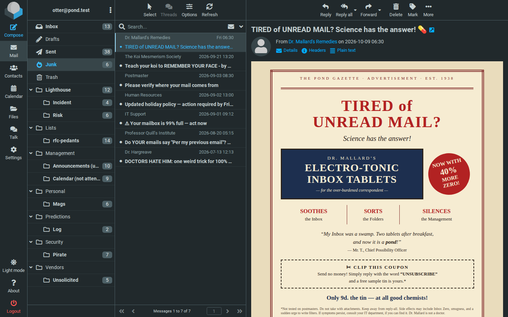
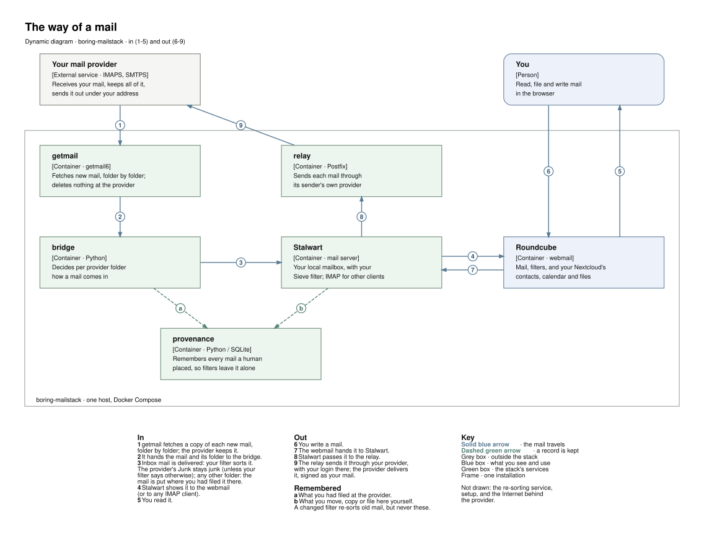

# boring-mailstack

Read mail from your existing providers in a webmail you run yourself.
Keep their delivery and sending services; use Roundcube for your daily
mail, with your Nextcloud contacts, calendar and files alongside it.

The useful difference is what happens to old mail. Change a filing rule
and the stack can apply it to messages already here, while respecting
mail you deliberately put somewhere yourself.

All of it — our code, tests, diagrams and docs — was written by AI
(OpenAI's models and Anthropic's Claude). Wald decided what to build,
tested it, ran it and had the last word.
[The story](docs/STORY.md) explains how that collaboration worked.



## Is this what you need?

boring-mailstack fits a home or small office with existing mail providers,
a Linux host with Docker, and an operator trusted with everyone's mail
credentials. Nextcloud is the tested companion for contacts, calendar and
files; the stack does not install or manage it.

It does not replace your providers or run an internet-facing MX. It also
does not make local and provider mailboxes identical in both directions.
It fetches mail and selected provider-side changes; your local filing is
not a general two-way sync. [What travels where](docs/WORKING_WITH_MAILSTACK.md#what-travels-where)
explains that boundary.

| You want to… | Start here |
|---|---|
| See it working without connecting real mail | [Try the demo](#try-it-with-fictional-mail) |
| Understand daily use and whether it fits | [Working with mailstack](docs/WORKING_WITH_MAILSTACK.md) |
| Install it for real accounts | [Deployment](DEPLOY.md) |
| Find a behaviour or limitation | [Using mailstack](docs/USING.md) |
| Understand the design or contribute | [Design](docs/DESIGN.md), [development](DEVELOPMENT.md) |

<picture>
  <source media="(prefers-color-scheme: dark)" srcset="docs/architecture/way-of-a-mail-dark.svg">
  
</picture>

## Change the rules without losing your filing

Suppose newsletters used to land in Inbox. You add a rule that puts them
in Reading. About a minute after you save it, the stack re-sorts eligible
old messages as well as handling new ones.

A message you moved into Keep stays there. The stack records that placement
as yours — **provenance** — so a later rule change does not undo it.
Moving mail back into Inbox deliberately hands it to the filter again.

That is what resieve and its watcher do: make filing rules useful for
an existing mailbox, not just tomorrow's arrivals.
[Try an example](docs/WORKING_WITH_MAILSTACK.md#reorganise-mail-you-already-have).
[Client and folder exceptions](docs/USING.md#filing-and-filter-changes) matter.

## Keep the provider's judgement

Your provider sees the original mail arriving and judges spam there.
The local stack does not put fetched Inbox mail through a second spam
assessment. Provider Junk stays Junk unless your configured rules move it.

Stored mail has no automatic age limit in the updated provisioning policy,
including Junk and Trash. Older releases need an explicit
[retention fix](DEPLOY.md#mail-retention).
Your provider has its own retention rules, and imported history may exist
only here: keep backups.

## Use the Nextcloud you already have

Each person adds their own Nextcloud connection in Roundcube. Contacts,
calendar and file integration use that connection; Files and Talk open
Nextcloud with its own browser login.

There is no shared Nextcloud credential and no new groupware server to
maintain. Only Nextcloud is tested for this integration.
[Connect it](docs/WORKING_WITH_MAILSTACK.md#bring-your-nextcloud-along).

## Try it with fictional mail

With Docker Compose, Python 3, OpenSSL and Git available, get the source
and start the demo:

```bash
git clone https://github.com/the-boring-crocodile/boring-mailstack.git
cd boring-mailstack
tools/demo up
```

It prints the URL and four logins. The demo runs the actual stack against
a simulated provider: four colleagues at Pond Ltd, one season of office
life, told through their mail. It cannot reach real mail providers.
Rootless Docker works.

When you are done:

```bash
tools/demo down --yes
```

That removes the demo and its local data. The [demo guide](demo/README.md)
explains the cast and environment.

## Run your own

[DEPLOY.md](DEPLOY.md) takes you from a checked release to a first login,
then covers configuration changes, upgrades, recovery and removal.
The installation is one Docker Compose project. Releases keep code
separate from configuration and data; the deploy tool verifies the artifact,
checks the installation and reports the result.

For everyday use, run webmail behind an HTTPS reverse proxy such as Caddy
to protect mail and login credentials in transit. The
[deployment guide](DEPLOY.md#reverse-proxy) covers host-based and containerised
proxies. Direct LAN HTTP remains available for a local trial.
The operator can read every mailbox; keep the admin endpoint private.

For the parts and their responsibilities, see
[design](docs/DESIGN.md) and [architecture](docs/architecture/README.md).
For changes in a particular release, see [CHANGELOG.md](CHANGELOG.md).

## Status

Used as its author's everyday mail reader since September 2026, on one
host. Maintained for its own use and shared with others; this is not a
claim of broad deployment experience. Issues and small changes are welcome
([CONTRIBUTING.md](CONTRIBUTING.md)); report security problems privately
([SECURITY.md](SECURITY.md)).

Start with the [working guide](docs/WORKING_WITH_MAILSTACK.md), or try the
demo above.

## Licence

Copyright Wald and the boring-mailstack contributors (all of it written by
AI, see the top of this page).

GNU Affero General Public License, version 3 or (at your option) any later
version: [LICENSE](LICENSE). Use it, change it, pass it on; whoever passes on a
changed version, or offers one to others as a network service, shares its
source under the same terms. No warranty.

`resieve` builds in Stalwart's `sieve-rs` (AGPL-3.0-only), so a `resieve`
binary is under AGPL-3.0 exactly. The patches in `roundcube/patches/` are
changes to Kolab's calendar plugins (AGPL-3.0) and Roundav
(AGPL-3.0-or-later) and stay under their licences.

The images are built from their upstream sources at install time, each
under its own licence; the main ones: Stalwart (AGPL-3.0), Roundcube
(GPL-3.0-or-later), Kolab's calendar plugins (AGPL-3.0), Roundav
(AGPL-3.0-or-later), RCMCardDAV (GPL-2.0-or-later), getmail6 (GPL-2.0),
Postfix (EPL-2.0 / IPL-1.0).
