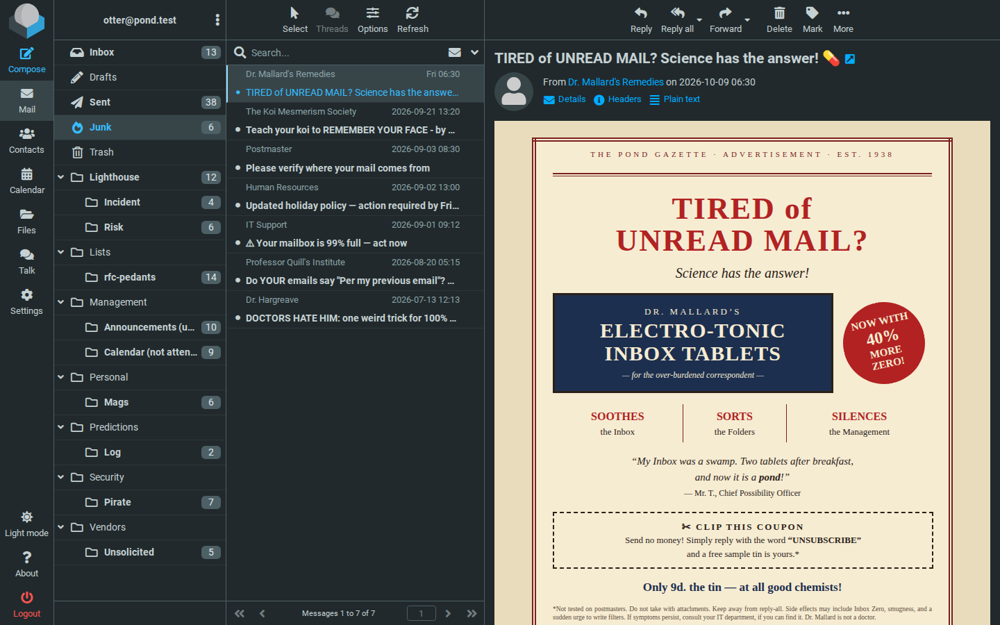

# boring-mailstack

A self-hosted mail stack for a small office or home. Your mail stays with
your providers; the stack mirrors it, remembers what you did with it, and
makes Roundcube the mail front of your Nextcloud.



## Five ideas

1. **A mirror, not a mailbox.** Every account's mail stays at its provider.
   The stack fetches it (nothing is deleted there), files it into a local
   [Stalwart](https://stalw.art) server folder for folder, and sends
   through each provider's own SMTP. It runs no MX of its own, and shows
   the provider's mailbox as it is.
2. **It remembers where a human put a mail.** Every move, copy or filing
   by a person is recorded (**provenance**), including what users had
   filed at the provider before the first fetch.
3. **Filters that respect people.** Change a filter, and a minute later it
   is applied to all the old mail too (`resieve`), except to what a person
   filed by hand.
4. **No spam filter of its own.** The provider judged every mail when it
   arrived; a second judge here sees only weak signals and hides real
   mail (measured: 7 of 25 good ones, even with its sender checks off).
   The verdict is the provider's and the user's.
5. **Built for people who live in Nextcloud.** Contacts, calendar, files
   and Talk come from each user's own Nextcloud, with the login they
   already have. On purpose: only Nextcloud is tested.

Boring on purpose: one host, Docker Compose, `docker compose up -d` in
its directory; releases as checked artifacts with a deploy that verifies,
smoke-tests and prints the way back; every image pinned. Made for people
who know each other and an operator they trust. Why it is built this way:
`docs/DESIGN.md`.

## Try it

```bash
tools/demo up       # prints the URL and four logins
tools/demo down --yes
```

The whole stack against a simulated provider, and the mailboxes of Pond
Ltd: four colleagues, one season, told only in email. Log in as any of them
and read their side of the story, including the man who suspects someone
knows where his emails come from (`demo/README.md`). Needs Docker with Compose,
`python3` and `openssl`; rootless Docker works. No real mail server can be
reached from the demo.

## Run it

`DEPLOY.md`: first installation (`tools/setup` writes the configuration,
`tools/deploy` installs), upgrades, rollback, backups.

## Where to look

| | |
|---|---|
| `docs/DESIGN.md` | the decisions that shape it, each with where to check it in the code and the tests |
| `docs/USING.md` | what happens to your mail, for the people who read it |
| `docs/STORY.md` | how it came to be, and how it was built by a human and an AI agent together |
| `DECISIONS.md` | every decision in full, with measurements and the alternatives rejected |
| `CHANGELOG.md` | what changed in each release, and how to upgrade |
| `DEVELOPMENT.md` | the test suites and where things are |
| `docs/architecture/README.md`, `roundcube/README.md` | the parts in detail |

## Inside


More pictures: [the containers](docs/architecture/mailstack.svg), [how provenance works](docs/architecture/how-provenance-works.svg) and [who is trusted](docs/architecture/who-is-trusted.svg) in [DESIGN.md](docs/DESIGN.md); [the life of a mail](docs/architecture/life-of-a-mail.svg) in [USING.md](docs/USING.md).

| Part | Does |
|---|---|
| getmail | fetches from the providers, certificates verified |
| bridge | delivers into Stalwart: the Inbox by SMTP, other folders by JMAP import (where it skips a mail already there) |
| Stalwart | the mail server your clients talk to (IMAP, JMAP, ManageSieve) |
| provenance | records where each mail came from and human moves |
| resieve, resieve-watch | apply the Sieve filter to existing mail, protecting human placements |
| relay | Postfix sending through each sender's provider |
| Roundcube | webmail with Filters, CardDAV, Kolab's calendar and Roundav (Nextcloud) |

## Status

Its author's everyday mail reader since September 2026, through the whole
of its development, on one host. Versions are `vYYYY.M.N`: year, month and
the release's number in that month (`v2026.10.13` is October's 13th
release, not a date); each release's changes and upgrade notes are in
CHANGELOG.md.
Maintained for its own use and shared: issues and small changes are
welcome (CONTRIBUTING.md), security problems privately (SECURITY.md).

## Licence

Copyright Wald and the boring-mailstack contributors. Much of the code was
written by AI (OpenAI's models and Anthropic's Claude) and reviewed and
tested by Wald; docs/STORY.md says who did what.

GNU Affero General Public License, version 3 or (at your option) any later
version: `LICENSE`. Use it, change it, pass it on; whoever passes on a
changed version, or offers one to others as a network service, shares its
source under the same terms. No warranty.

`resieve` builds in Stalwart's `sieve-rs` (AGPL-3.0-only), so a `resieve`
binary is under AGPL-3.0 exactly. The patches in `roundcube/patches/` are
changes to Kolab's calendar plugins (AGPL-3.0) and Roundav
(AGPL-3.0-or-later) and stay under their licences.

The images are built from their upstream sources at install time, each
under its own licence; the main ones: Stalwart (AGPL-3.0), Roundcube
(GPL-3.0-or-later), Kolab's calendar plugins (AGPL-3.0), Roundav
(AGPL-3.0-or-later), RCMCardDAV (GPL-2.0-or-later), getmail6 (GPL-2.0),
Postfix (EPL-2.0 / IPL-1.0).
