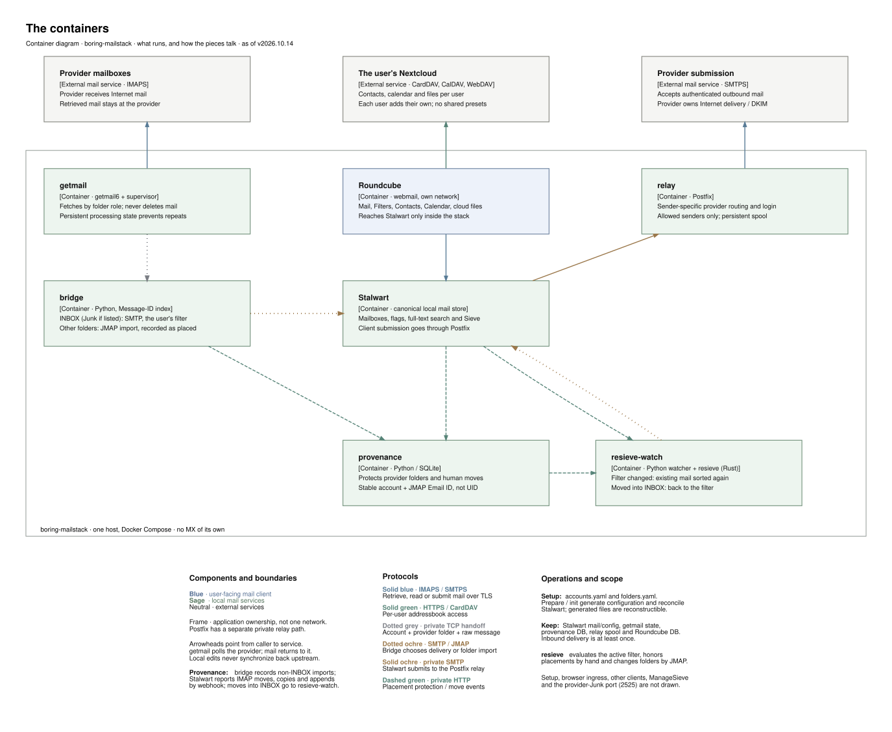
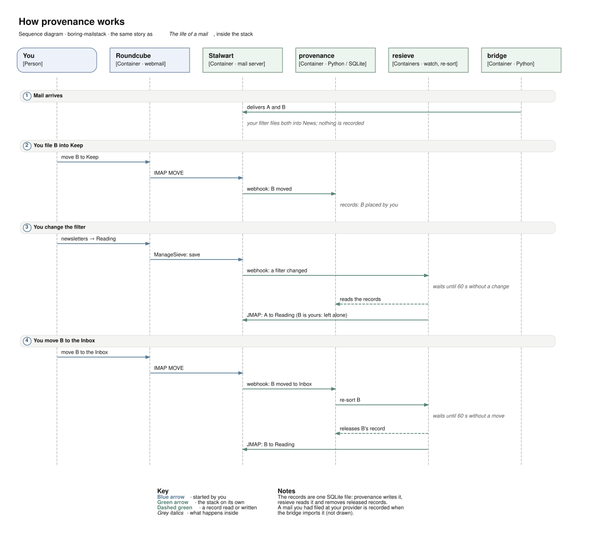

# Why mailstack works this way

The stack gives existing provider accounts a local place to work. Its design
serves two everyday needs: make old mail respond to useful new rules, and keep
those rules from undoing deliberate filing.

[Working with mailstack](WORKING_WITH_MAILSTACK.md) shows those needs in use.
This page explains the choices; [architecture](architecture/README.md)
owns the detailed component and protocol description.

<picture>
  <source media="(prefers-color-scheme: dark)" srcset="architecture/mailstack-dark.svg">
  
</picture>

## Keep internet delivery with the providers

Running a mailbox does not require taking over every responsibility of an
internet mail service. Providers already receive mail for these addresses,
judge incoming spam and authenticate outgoing messages.

getmail fetches over IMAPS; Stalwart stores the local messages; the relay sends
through each address's provider. No local MX receives internet mail.
This avoids owning sender reputation and public inbound delivery.

It is a local working copy, not unrestricted two-way synchronisation.
Provider placements can be reflected when fetched; local filing is not replayed
as a complete set of provider edits. The stack cannot recreate imported
history that has disappeared from its source.
[The direction of changes](WORKING_WITH_MAILSTACK.md#what-travels-where) is part
of the contract, not an implementation detail.

## Remember the decisions people made

A changed rule should sort yesterday's newsletters. It should not
take a message out of a folder where someone deliberately put it.

Provenance records supported human placements, both in provider folders before
fetching and through IMAP actions locally. resieve consults those records before
re-filing old mail. Moving a message back into Inbox is the explicit hand-back
to filtering.

This is why provenance and resieve are separate responsibilities. One records
placement; the other evaluates the current rules. Known client/event limits
remain visible in [the behaviour reference](USING.md#filing-and-filter-changes).

How the two work together, call by call:

<picture>
  <source media="(prefers-color-scheme: dark)" srcset="architecture/how-provenance-works-dark.svg">
  
</picture>

Implementation: `mail-provenance/`, `resieve/`, `bridge/`.
Checks: `tests/unit/test_provenance.py`, `tests/demo/verify_import.py`,
`tests/demo/inbound.py`.

## Keep the provider's spam verdict

A fetched message no longer arrives over its original connection.
Assessing it again locally can mistake the fetcher's connection for the sender's.

In the recorded test, a second filter marked 7 of 25 legitimate Inbox messages
as junk even with sender checks disabled. That observation justified keeping
the provider's judgement; it is not a general benchmark of spam-filter quality.

Provider Junk remains junk unless the user's configured rules rescue it.
There is no second independent spam judgement over fetched Inbox mail.
The bridge and Stalwart provisioning own that distinction; provider-Junk and
“not spam” cases are exercised in `tests/demo/inbound.py`.

## Retain mail until someone chooses to remove it

Old mail is often the reason to keep a local store. A default timer that deletes
Junk and Trash undermines that purpose, particularly after importing history.

Updated provisioning explicitly disables Stalwart's age-based Trash/Junk
expiry for every account. This leaves user deletion, user-authored
discard rules and cleanup of unreferenced storage intact.
Older installations need [the retention fix](../DEPLOY.md#mail-retention).
The provisioner and `tests/unit/test_retention.py` own this policy.

Providers can expire their own copies. Backups must cover the local
data and configuration, not just credentials for fetching again.

## Reuse the Nextcloud people already maintain

A second addressbook, calendar and file store would create another
synchronisation problem. Roundcube instead uses each person's own Nextcloud
connection, added through CardDAV settings, for the combined integration.

There is no shared login between users. Files and Talk retain Nextcloud's own
browser sign-in; the server-side connection is not single sign-on.
Only Nextcloud is tested as the combined service.

The integration lives in `roundcube/plugins/mailstack_cloudfiles/`, with
Kolab calendar and Roundav dependencies. PHP unit and demo cloud checks
exercise it. Small upstream patches remain visible in
[the Roundcube documentation](../roundcube/README.md).

## Make the operator's responsibilities explicit

One trusted operator runs one Compose installation. That operator holds
provider credentials and can read every mailbox. Users are trusted with the
LAN destinations they enter for Nextcloud connections; this is not a
multi-tenant service for strangers.

Roundcube is separated from the stack's internal services. Provider connections
verify certificates. Internal Stalwart TLS and unsigned webhook boundaries
are described in [architecture](architecture/README.md#networks).
Default LAN web endpoints use plain HTTP. For everyday browser access we
recommend HTTPS through your chosen reverse proxy; Caddy is one example in
[Deployment](../DEPLOY.md#reverse-proxy). Keep the admin endpoint private.

<picture>
  <source media="(prefers-color-scheme: dark)" srcset="architecture/who-is-trusted-dark.svg">
  
</picture>

Release artifacts separate code from configuration and data. Deploy checks,
switches, starts and smoke-tests, then records the result. A rollback is
available only where the data format permits it; a one-way change needs the
appropriate backup.

Pinned dependencies and exact patches limit surprise. They do not guarantee
that external build services remain available forever.
[Deployment](../DEPLOY.md) covers installation and recovery; [development](../DEVELOPMENT.md)
lists the checks that support a release.

The fuller choices and rejected alternatives remain in [DECISIONS.md](../DECISIONS.md).
