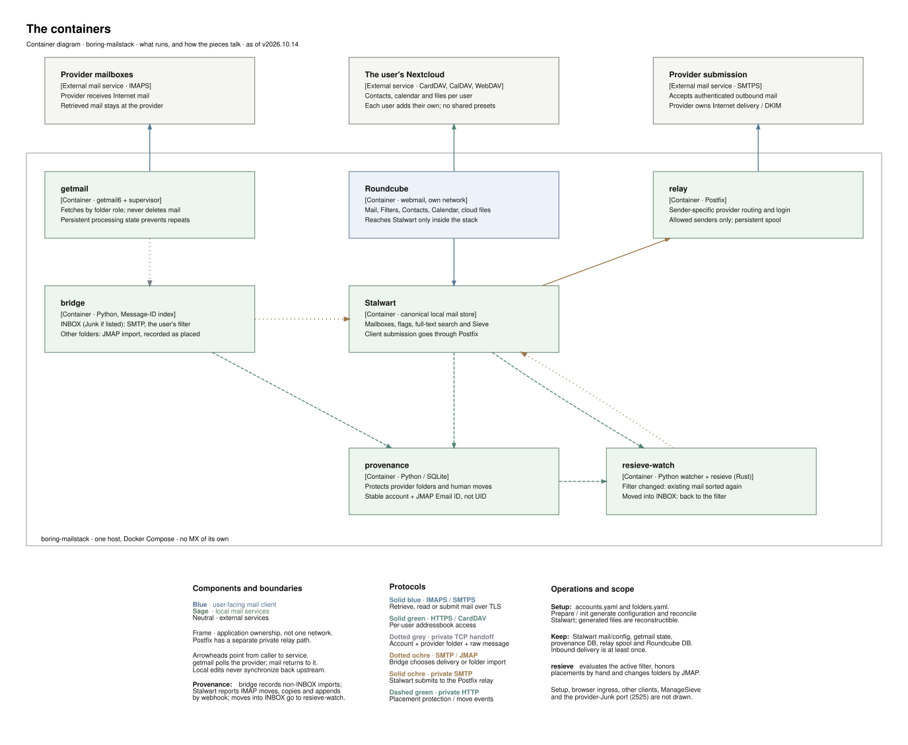

# Design

The decisions that shape boring-mailstack, distilled. Each one says what,
why, what was rejected, and where the code and the tests are; the full
reasoning, with measurements and dates, is the named entry in
`DECISIONS.md`.

The short version: mail stays with the providers and is mirrored as it is;
the stack remembers what people did with it, so filters can be re-applied
without undoing anyone's own filing; it adds no judgement of its own; it
is built for people who keep their calendars and files in Nextcloud; and
it is run like a boring appliance.

## 1. A mirror, not a mailbox

**What.** Every account's mail stays at its provider. The stack fetches it
over IMAPS without deleting anything there, files it into a local Stalwart
server folder for folder, and sends through each provider's own SMTP with
its DKIM. It runs no MX and never receives mail from the Internet itself.
It shows the provider's mailbox as it is: a label that happens to be called
"Sent" stays a folder next to the real Sent, and a mail's arrival date is
when the stack fetched it.

**Why.** Deliverability, spam defence and storage stay with providers that
do them well; the stack can be removed, or rebuilt from nothing, without
losing mail. A mirror that tidies things up becomes less trustworthy than
the original.

**Not this.** A mail server of its own (MX, reputation, spam defence); a
"cleaner" view that hides or renames what the provider has.

**Where.** `getmail/` (fetch, certificates verified), `bridge/` (into
Stalwart), `relay/` (Postfix through the providers, TLS verified).
Tests: the acceptance round trip and "mail to oneself"
(`tests/demo/roundtrip.py`). DECISIONS: "Mirror what is there, as it is".

## 2. Provenance: the stack remembers where a human put a mail

**What.** `mail-provenance` records every placement made by a person: a
move, copy or append in an IMAP client or the webmail (reported by
Stalwart's webhook), and every mail fetched from a provider folder other
than the Inbox (placed there by the user at the provider). Deliveries,
filter placements and the stack's own moves are never recorded as human.

**Why.** It is what makes re-sorting old mail safe (3). Without it, a
filter change would undo years of hand filing.

**Not this.** Guessing from flags or dates; a rule of "protect what we have
not heard of", which failed open (every placement nobody reported was free
to move).

**Where.** `mail-provenance/provenance.py`, recorded imports in
`bridge/bridge.py`. Tests: "human move" (`tests/demo/roundtrip.py`), the
first import with provenance for every mail outside the Inbox
(`tests/demo/verify_import.py`), `tests/unit/test_provenance.py`.
DECISIONS: "resieve puts unprotected mail where the filter says;
protection is for human placements".

## 3. Filters that respect people

**What.** `resieve` applies the user's Sieve filter to mail already in the
mailbox, and puts every mail that no human placed exactly where the filter
says. It runs by itself a minute after the filter changes
(`resieve-watch`). Moving a mail into the Inbox hands it back to the
filter: a matching rule files it, no rule leaves it in the Inbox.

**Why.** Users change filters over years; without this, a new rule only
applies to new mail, and restructuring folders means sorting by hand.

**Not this.** A one-off "apply filter to folder" button that moves
everything, including mail a person filed deliberately.

**Where.** `resieve/` (Rust, the Sieve engine of Stalwart), `resieve/watch.py`.
Tests: `cargo test` in `tests/unit/run.sh`; "filter change" and "re-sort
chute" (`tests/demo/inbound.py`). DECISIONS: "Automatic resieve after a
filter change", "Moving a mail into INBOX hands it back to the filter".

How 2 and 3 work together, call by call:

## 4. No spam filter of its own

**What.** The spam verdict is the provider's, plus what the user does
(spam / not spam, filters). Mail from the provider's Junk stays junk; the
user's filter may still take it out.

**Why.** Every mail was judged at arrival by a provider that saw the real
connection. Re-checked here, every fetched mail fails the sender checks
(Stalwart sees the stack, not the sender), and even with those switched
off the content rules alone put 7 of 25 good Inbox mails into Junk in a
measurement with real mail. A filter that hides real mail does more harm
than one that lets a spam through.

**Not this.** A second filter with the sender checks off; reading the real
sender from the `Received:` lines (the trust boundary would have to be
guessed per provider).

**Where.** `bridge/bridge.py` (Inbox by delivery without the spam filter,
provider Junk on its own port), `tools/stalwart-provision.py`. Tests:
"provider Junk" and "not spam" (`tests/demo/inbound.py`), the Gmail-like
"labels" checks (`tests/demo/labels.py`). DECISIONS: "No second spam
filter on fetched mail", "Three ways in".

## 5. Built for people who live in Nextcloud

**What.** The webmail becomes Nextcloud's mail front: contacts, calendar,
files and Talk come from each user's own Nextcloud, with the login they
already gave the webmail for their contacts. The stack owns no part of
anyone's Nextcloud and never stores a second password; without a
Nextcloud, those parts stay hidden.

**Why.** Nextcloud is where many small offices already keep calendars and
files. A second groupware beside it would double what people look after.

**Honest edges.** The identity check, the file paths, the Talk link and the
folder counts are Nextcloud's. Contacts and calendar speak CardDAV and
CalDAV, so other servers may partly work; only Nextcloud is tested. No
single sign-on: the Files and Talk links open Nextcloud with its own login.

**Not this.** Nextcloud's calendar in a frame; presets that share one
user's credentials with all; a Nextcloud run by the stack.

**Where.** `roundcube/plugins/mailstack_cloudfiles/`, Kolab's calendar and
Roundav built into `roundcube/Dockerfile`. Tests: the "cloud" checks in
`tests/demo/roundtrip.py`, browser checks in `tests/browser/`,
`tests/unit/test_cloudfiles.php`. DECISIONS: "CardDAV addressbooks are
added by each user", "Calendar and files in Roundcube, from the user's
Nextcloud via CardDAV", "No single sign-on into Nextcloud".

## 6. Each account is its real address

**What.** A user logs in with their address, and that address is the
account. Vacation replies and redirects leave from it, through the
provider.

**Why.** With an internal account name, vacation replies and redirects
left from that name, and the relay (which sends only for the configured
addresses) refused them.

**Not this.** A sender-rewriting table in the relay (one more translation
layer to look after).

**Where.** `tools/stalwart-provision.py`. Test: a vacation reply from the
real address (`tests/demo/vacation.py`). DECISIONS: "Each account is its
real address".

## 7. Boring operations

**What.** One host, Docker Compose. The installation is a plain Compose
project: `docker compose up -d` and `down` in its directory, with the files
an operator edits at the top. Releases are artifacts built from a tag with
a manifest of every file; `tools/deploy` verifies, builds, checks, switches,
starts and smoke-tests, records the deployment and prints the way back.
Every base image is pinned by digest, the PHP packages by lock file.

**Why.** An operator should be able to install, upgrade, roll back and
remove it without knowing its insides, and the same release should build
the same way next year.

**Not this.** A Git checkout on the server; copying new code over old;
images that float with a tag.

**Where.** `tools/deploy`, `tools/make-release`, `tools/setup`,
`tools/uninstall`, `DEPLOY.md`. Tests: `tests/deploy/run.sh` (first install,
upgrade, refusals, rollback; case K refuses a rollback across a data
change; case M plain `docker compose`; case N an upgrade of an older
layout), `tests/first-install/run.sh`, `tests/trial/run.sh` (installed and
removed twice, nothing left). DECISIONS: "Install layout",
"Releases are checked by their manifest", "The home is a plain Compose
project", "Every base image pinned by digest".

## 8. Made for a small office: who is trusted, stated plainly

**What.** The stack is built for a small office or home: one machine, a
handful of people who know each other, and an operator they rely on. It
draws three circles and says which is which.

- **The operator (root on the host) is trusted completely.** They hold
  every provider password (`accounts.yaml`) and can read every mailbox,
  as the administrator of any mail server can. Nothing in the stack tries
  to protect users from the operator; it protects the operator's secrets
  from everyone else.
- **Users with an account are trusted** not to attack the office: the
  webmail connects to the CardDAV and Nextcloud addresses they type in,
  which may lie on the LAN. It cannot reach the stack's own services:
  Roundcube sits on a network with the mail server only. Users are kept
  apart from each other (each one's Nextcloud login is theirs alone).
- **The LAN is trusted by default:** webmail and admin page are plain
  HTTP on the machine's LAN address. Anywhere else, a TLS reverse proxy
  in front and a bind to `127.0.0.1`.

![Who is trusted: three nested circles. Innermost, you as root and the stack itself, fully trusted. Around it everyone with an account, trusted not to attack the office; Roundcube shares a network with the mail server only, so addresses users type in never reach the stack's own services. Outermost the LAN, trusted by default. Outside, not trusted: other users of the machine (deploy refuses while the secrets are open to them), the Internet (only through a TLS reverse proxy) and the way to your providers (certificates verified).](architecture/who-is-trusted.svg)

Everything outside these circles is not trusted: other local users of the
host (deploy refuses to run while `etc/` or `accounts.yaml` is open to
them), and the providers' network path (certificates verified for fetching
and sending). Inside the stack, TLS to the mail server is not verified,
and Stalwart's webhooks to provenance and resieve-watch are not signed:
whoever can join that network could mark mail as placed by a person, but
can already read every mailbox and the secrets anyway.

**Why.** Saying whom a system trusts is the start of every honest
security statement. For a family or a small office, a trusted
administrator is how things are; designing against them would add
complexity (end-to-end encryption, split secrets) that this setting does
not need, and would still not stop someone with root.

**Not this.** A multi-tenant service for strangers; per-user encryption
the operator cannot read.

**Where.** DEPLOY.md, "Assumptions". `tools/deploy` (the privacy check,
and a smoke step every deployment runs: "Roundcube reaches Stalwart
only"), `compose.yaml` (networks). Tests: case J in `tests/deploy/run.sh`;
the smoke step runs in every deploy test. DECISIONS: "etc/ is private",
"Roundcube on its own network", "Inside the stack, TLS to Stalwart is not
verified", "CardDAV addressbooks are added by each user".

## 9. Upstream, not forks

**What.** Where a component needed a fix (Kolab's calendar plugins,
Roundav), the change is a small patch applied exactly at build time and
offered to its maintainers. A patch that no longer applies fails the
build instead of disappearing.

**Why.** A fork is a second project to maintain. Roundav took most of the
changes into its release 3.2.0; one patch is left.

**Where.** `roundcube/patches/`, `roundcube/Dockerfile`, `roundcube/README.md`.
