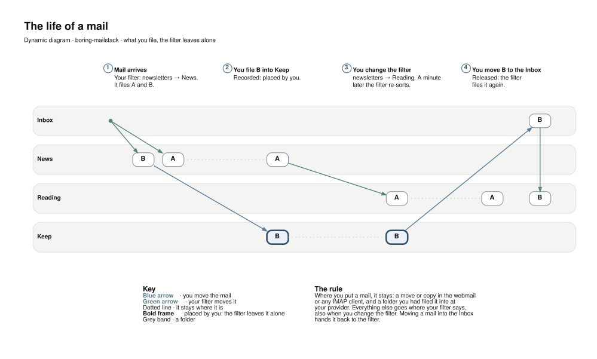

# Using boring-mailstack

This is the behaviour reference for people reading mail in Roundcube.
For a guided introduction, see [Working with mailstack](WORKING_WITH_MAILSTACK.md).
Installation and account configuration belong to the operator:
[DEPLOY.md](../DEPLOY.md).

## Sign-in and accounts

Use your full mail address and its inbound provider password at the webmail
URL your operator supplies. If that password changes at the provider, tell
the operator: retrieval and local account configuration need the new value.

Sending uses that address's configured provider. The local installation does
not replace the provider's internet mail service.

## Keeping mail

Updated provisioning gives stored mail no automatic age limit,
including Junk and Trash. Older releases need the
[retention mitigation](../DEPLOY.md#mail-retention).

Emptying a folder or permanently deleting messages in a client still removes
mail. User-authored discard rules can discard incoming messages. Provider
retention is independent, and imported history may exist only locally.
Keep backups.

## Arriving mail

| Source | Local behaviour |
|---|---|
| Provider Inbox | Uses configured filtering; no matching filing rule means Inbox |
| Another provider folder | Arrives in the corresponding folder and is recorded as already filed |
| Provider Junk | Remains junk; configured filtering may rescue it into another folder |
| Mail you send to yourself | Arrives through the provider; the Sent copy remains separate |

The operator controls which delivery folders use the filter. A new account's
first fetch brings the history from its fetched folders; this can take time.

A restart or update does not normally fetch already-recorded mail again.
A crash around delivery can still produce a duplicate. Fetch state is not a
substitute for backups.

## Provider changes

Moves encountered at the provider's destination folder are reflected locally
and count as deliberate placements. Provider Sent copies are recognised so
they do not appear a second time beside the local Sent copy.

For Gmail, several labels can give one message several local folder
memberships. Spam and Trash are treated as placements, not ordinary extra
labels. A spam/trash action there moves mail locally to that destination;
a later “not spam” or restore there can bring it back.

Gmail's All Mail view is not fetched. Removing its Inbox label without adding
a fetched destination — archiving only in Gmail — can leave the mail in the
local Inbox. A message disappearing entirely at a provider does not
by itself request local deletion.

Local filing is not a general two-way sync to the provider.
[What travels where](WORKING_WITH_MAILSTACK.md#what-travels-where) gives the overview.

## Filing and filter changes

About a minute after a filter is saved, resieve re-evaluates eligible existing
mail. It respects recorded human placements and skips Sent, Drafts, Trash
and Junk by default. An operator can allow the filter to pull mail out of Junk;
mail filed elsewhere then loses its junk mark.

| What you do | What it means for later filtering |
|---|---|
| Move or copy mail into an ordinary folder in Roundcube or IMAP | Record your placement and protect it |
| Move mail back into Inbox | Hand it back to the filter; no matching rule leaves it in Inbox |
| Move mail into Junk | May hand it back, according to the account's Junk re-sorting policy |
| Change a filing rule | Re-sort eligible existing mail, preserving read/unread flags |

Re-sorting old mail does not send vacation replies, redirects or new copies.
If automatic re-sorting repeatedly fails, a notice is placed in Inbox;
saving the filter again retries it.

<picture>
  <source media="(prefers-color-scheme: dark)" srcset="architecture/life-of-a-mail-dark.svg">
  
</picture>

**Client limits:** moves by JMAP clients are not noticed as human placements.
An IMAP APPEND without a Message-ID cannot be recorded through the same
mechanism; Roundcube supplies one. These limits matter when choosing another
client or import tool.

Moving a message out of Junk into Inbox removes the Junk placement; a matching
filing rule may still put it elsewhere.

## Replies, redirects and historical imports

Vacation replies go only to mail naming your address in To or Cc. They do not
answer group addresses, mailing lists, bulk mail or automatic messages, and
answer each sender once per configured interval. They can answer spam addressed
directly to you: this rule does not consult the spam verdict.

**Before an initial import or re-import:** disable vacation replies and
redirects that should not run for historical mail. Delivery filtering can
execute them even though the message is old. Re-enable them after checking
the import.

A reject rule discards silently here. The provider already accepted the
message, so no rejection bounce goes back to the original sender. Use discard
or a Trash-folder filing rule to express the intended outcome.

## Contacts, calendar and files

Add your own Nextcloud under Settings → CardDAV, preferably with an app
password. Contacts, calendar and cloud-file integration use that connection.
Only Nextcloud is tested for the combined integration.

Files and Talk open Nextcloud in a new tab with its own browser login.
The webmail's server connection cannot sign your browser in. Signing into
Nextcloud there with “Stay logged in” avoids repeating that step while its
session remains valid.

## Dark mode

Personal HTML mail without its own colours gets a dark background and light
text. Designed mail such as newsletters keeps its own colours, usually on
white, so its layout stays readable.

Settings → Preferences → Displaying Messages → “HTML mail in dark mode”
also offers inversion of every HTML message, or an always-white display.

For a practical walkthrough, return to [Working with mailstack](WORKING_WITH_MAILSTACK.md).
If fetching or sending stops, contact the operator before resetting an account
or repeating an import.
